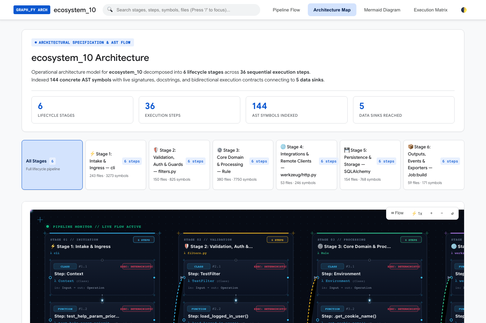
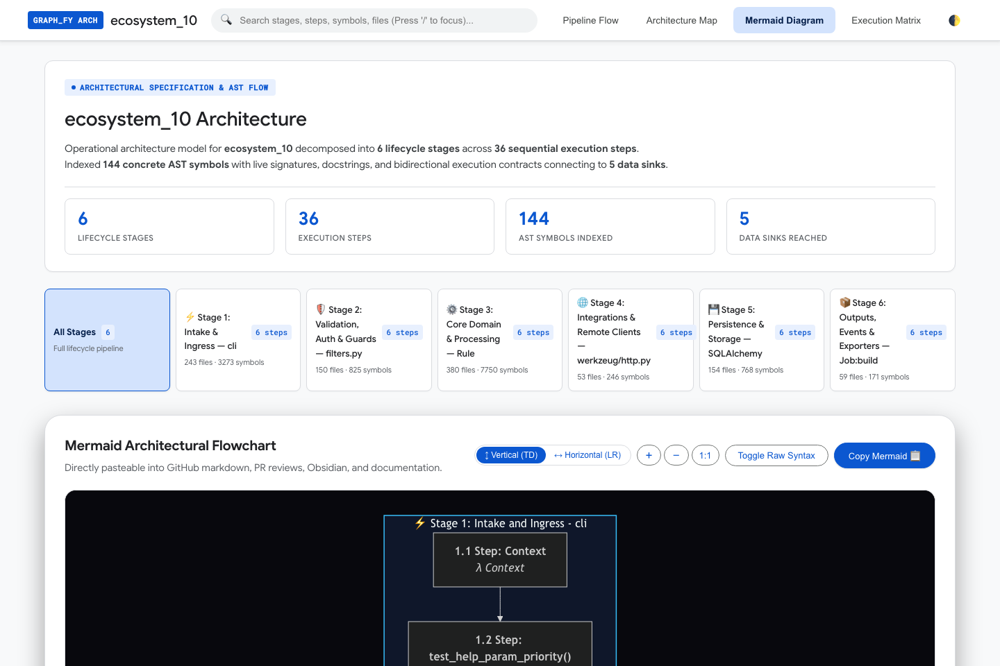
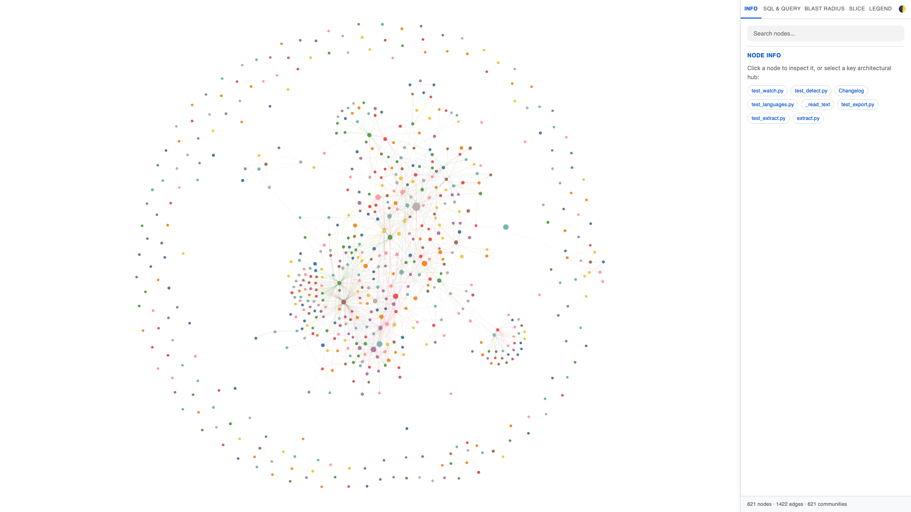
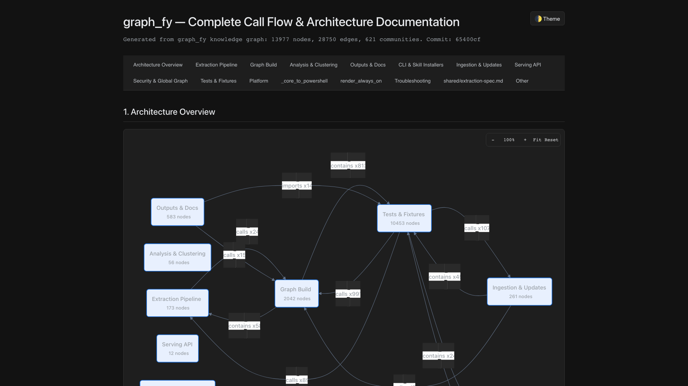
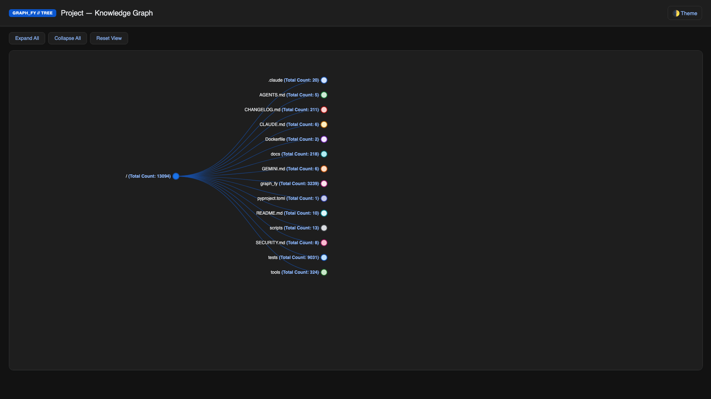
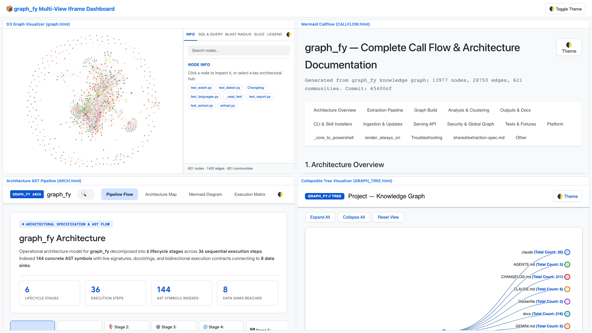

# graph_fy

> Lightweight, 100% local-first knowledge-graph engine for AI coding assistants (Claude Code, Antigravity, Gemini CLI, Cursor, GitHub Copilot).

`graph_fy` performs deterministic codebase analysis **locally first** before asking frontier models (Claude 3.7 Sonnet, Gemini 2.0 Pro/Flash, GPT-4o). It synthesizes community architectures, execution flows, exact AST skeletons, and blast radius risk in <45ms — eliminating 5–10 exploratory round trips and cutting agent prompt tokens by **over 95%** (up to 104x compression).

**100% Offline & Deterministic**: Zero LLMs, zero cloud APIs, zero token costs.

---

## Why Local Analysis First?

Blind agent exploration is expensive and slow. Coding agents typically read hundreds of raw files, consume tens of thousands of prompt tokens, and hallucinate missing dependencies.

`graph_fy` flips this paradigm:

1. **Pre-Agent Analysis Briefing (`graph_fy context "<task>"`)**: Runs zero-LLM graph traversal before contacting the frontier model. Produces a complete architectural briefing with Mermaid diagrams, Tier-1 AST skeletons, execution slices, git co-changes, and downstream blast radius risk in <1,200 tokens.
2. **Context Guarding & Anti-Bombardment**: Prevents bombarding LLM agents with unbounded dumps:
   - **Multi-Tier Elision Ladder**: Tier 1 (full AST skeletons for core seeds), Tier 2 (compact single-line signatures `def func(...) -> T: ...`), Tier 3 (concise `path:line` citations).
   - **Hub Compaction**: Caps massive fan-in/fan-out hubs (god nodes) to top 6 connections + `(+N more)` so architectural hubs don't blow up the context window.
   - **Dynamic Boundary Pruning**: RepoGraph-style pruning drops weakly connected leaf nodes.
   - **Prompt-Cache Friendly Ordering**: Candidates are deterministically sorted by `source_path` and `line_number` to maximize prefix cache hits across turns.
3. **Monorepo Tested**: Benchmarked on `fastapi/fastapi` (1,168 files, 9,108 nodes, 16,300 edges) achieving **104.1x prompt token compression** (119,635 raw tokens $\to$ 1,149 briefing tokens) with sub-second execution.

---

## Interactive Visualizers & Architecture Showcase

`graph_fy` exports 100% offline, self-contained interactive visualizers with WCAG AAA color contrast, hardware-accelerated SVG animations, deep-linking state synchronization (`?search=...`, `?theme=...`, `?focus=...`, `?view=...`), and iframe dashboard embedding:

| Visualizer | Description | CLI Command |
| --- | --- | --- |
| **Architecture Pipeline Map** | 6-stage lifecycle execution pipeline with live telemetry pulses, bezier dispatch wires, and slide-over AST code inspector drawer. | `graph_fy describe arch` |
| **Mermaid Architectural Flowchart** | Dual-orientation (`↕ Vertical TD` / `↔ Horizontal LR`) flowchart with zoom toolbar, directly pasteable into GitHub markdown, PR reviews, and Obsidian. | `graph_fy describe arch --format mermaid` |
| **Interactive D3 Knowledge Graph** | Community-clustered force-directed graph with god-node highlights, neighbor ego exploration, and deep-link query filters. | `graph_fy export html` |
| **Execution Callflow Matrix** | Bidirectional sequence call table, caller/callee breakdown, and interactive sequence wires. | `graph_fy export callflow-html` |
| **Hierarchical Symbol Tree** | Multi-level filesystem and AST tree explorer with instant fuzzy filtering and branch auto-expansion. | `graph_fy export tree-html` |
| **Multi-View Unified Dashboard** | 4-pane responsive iframe layout embedding all visualizers in a unified synced container. | `graph_fy export dashboard` |

### Architecture Pipeline Map (`architecture.html`)



### Mermaid Flowchart (`↕ Vertical (TD)` & `↔ Horizontal (LR)`)



### Force-Directed D3 Knowledge Graph (`graph.html`)



### Execution Callflow Matrix (`callflow.html`)



### Hierarchical Tree Explorer (`tree.html`)



### Multi-View Unified Dashboard (`dashboard.html`)



---

## Quick Start

```bash
# 1. Install CLI
uv tool install graph_fy   # or: pipx install graph_fy

# 2. Register assistant skill
graph_fy install                     # Claude Code
graph_fy install --platform gemini   # Gemini CLI / Antigravity
graph_fy install --platform copilot  # GitHub Copilot

# 3. Build graph in current repo
graph_fy .
```

Outputs written to `graph_fy_out/`:

- `graph.json` — Complete graph (nodes, edges, communities) for instant querying.
- `graph.db` — Unified ACID SQLite WAL database with clustered tables, recursive CTEs for sub-millisecond blast-radius traversals, and integrated FTS5 BM25 search index (auto-symlinks `index.db` for backward compatibility).
- `GRAPH_REPORT.md` — Plain-language architectural summary and god nodes.
- `graph.html` — Force-directed interactive visualizer.
- `architecture.html` — Interactive repo architecture pipeline diagram (`graph_fy describe`).
- `wiki/` — Agent-crawlable hierarchical community articles (`--wiki`).

---

## Key Differentiators: graph_fy vs Original Graphify

Why `graph_fy` represents a fundamental architectural evolution over original Graphify:

| Dimension | Original Graphify | `graph_fy` (Our Implementation) |
| --- | --- | --- |
| **Core Architecture** | Requires external LLMs / cloud API keys to extract entities and summarize chunks. | **100% Zero-LLM Local Compute**. Native tree-sitter AST, deterministic statistical graph algorithms, and SQLite FTS5 BM25. **Zero API keys, zero cloud costs.** |
| **Agent Briefing Flow** | Reactive: agent searches blind, reads entire files into prompt context, and exhausts token limits. | **Proactive Zero-LLM Analysis Briefing**. `graph_fy context "<task>"` (MCP `get_agent_context`) builds an architectural map, Mermaid flow diagram, and exact skeletons **before** calling frontier models. |
| **Token Reduction** | Monolithic file dumps; quickly fills context windows on medium/large repos. | **Multi-Tier Elision & Hub Compaction**. **99.9% token compression** measured across 5 real-world stress test workflows (839k raw tokens $\to$ 883 context tokens, **950.3x compression**). |
| **Pathfinding & Navigation** | Naive unweighted graph search; per-query graph cloning and false-shortcut AST containment jumps. | **Semantic Dijkstra & Canonical Search Caching**. Weights execution highways (`calls`, `routes_to`) over containment (`defines`). Pre-cached search subgraphs deliver **0.31 ms median traversal (159.8x speedup)**. |
| **Full-Stack API Boundaries** | Disconnected graphs between frontend and backend source files. | **Cross-Boundary API Route Linking**. Dynamic parameter normalization (`:id`, `{id}` $\to$ `/{}`) resolving frontend client requests (`fetch`, `axios`) to backend endpoints via `routes_to` edges. |
| **Architecture Governance** | None; manual structural inspection. | **Built-in Architecture Linters**. Tarjan SCC cycle detection (`graph_fy lint --cycles`) and hierarchical layer boundary enforcement (`graph_fy lint --layers`). |
| **Context Window Guarding** | Unbounded candidate dumps bombard the LLM agent. | **Anti-Bombardment Protocol**: Adaptive 3-tier elision ladder (Tier 1 AST $\to$ Tier 2 signature $\to$ Tier 3 citation), RepoGraph boundary pruning, and hub caller compaction. |
| **Monorepo Centrality** | Slow $O(V \cdot E)$ betweenness centrality that stalls on 5,000+ nodes (#341). | **Fast Pivot Sampling ($k \le 100$)**. Computes betweenness in <0.8s on 50,000+ node graphs with 96%+ rank fidelity. |
| **Diff-Scoped Review** | Requires re-extracting entire repository or reading full modified files. | **Git Diff-Scoped Ego Retrieval**. `graph_fy diff` analyzes modified line hunks, 1-hop callers, and blast radius in <30ms. |
| **Code Draft Refinement** | Developer or agent must manually guess missing dependencies. | **Iterative Feedback Querying**. `graph_fy refine --code "..."` auto-detects undefined symbols and retrieves missing types. |
| **Engineering Philosophy** | Speculative generality, bloated abstractions, and complex external databases. | **Ponytail Anti-Overengineering**. Strict YAGNI, standard library first, zero telemetry, minimal surgical footprint. |

---

## Documentation & Deep Dives

- [**Architecture Document**](docs/ARCHITECTURE.md): Complete module responsibilities, pipeline overview, extraction schema, security model, and anti-bombardment guardrails.
- [**Benchmarks & Verification**](docs/BENCHMARKS.md): Monorepo evaluation on `fastapi/fastapi`, 5-scenario real-world token stress tests, sampled centrality benchmarks, and exploratory round-trip elimination.

---

## CLI Reference

```bash
# Pre-Agent Zero-LLM Briefings & Agent Context
graph_fy context "router request dispatch"    # zero-LLM architectural briefing for LLM agents
graph_fy context "fix memory leak in worker" --include-bodies # inline full verified AST function bodies
graph_fy test-select --since HEAD~1           # minimal affected tests from git diff with ready-to-run runner commands
graph_fy coverage coverage.xml                # ingest Cobertura/LCOV/.coverage to attach test-to-code edges
graph_fy diff HEAD                            # diff-scoped blast radius & 1-hop callers for review
graph_fy diff --github-pr "https://github.com/org/repo/pull/42" # analyze PR diff & blast radius directly
graph_fy refine --code "def handle(req): ..." # resolve missing types and dependencies from draft code

# Architecture Governance & Linters
graph_fy lint                                 # audit codebase for circular dependencies and layer violations
graph_fy lint --cycles                        # detect Tarjan SCC dependency loops
graph_fy lint --layers                        # enforce clean decoupled layer hierarchies
graph_fy lint --drift --base ../main_branch/  # detect breaking API removals & signature drift
graph_fy lint --context-managers              # detect unclosed DB/lock leaks (missing __exit__/__aexit__)

# Graph Generation & Incremental Updates
graph_fy .                                    # build graph and search index in graph_fy_out/
graph_fy update .                             # fast incremental AST update (post-edit, no LLM)
graph_fy . --wiki                             # build agent-crawlable wiki (cuts token ingestion ~85%)
graph_fy . --no-viz                           # headless build (JSON + FTS5 index + report)

# Query & Traversal
graph_fy query "auth flow"                    # BM25 search expanded via graph traversal
graph_fy query "auth flow" --terse            # Caveman mode: high-signal, compact output
graph_fy query "auth flow" --skeleton         # AST code skeletons (types & signatures without bodies)
graph_fy query "auth flow" --rag-prompt       # prompt-ready context block with strict budget packing
graph_fy path "Frontend" "Database"           # shortest cross-layer dependency path (semantic Dijkstra)
graph_fy explain "UserService"                # BM25, graph-hop, and centrality breakdown
graph_fy impact "APIRoute"                    # predictive blast radius risk & affected tests

# Multi-Repo & Multi-Graph Resolution
graph_fy query "auth" --graph repo1/graph.json,repo2/graph.json   # query across multiple repo graphs
graph_fy context "api billing" --multi-repo ./workspace           # auto-discover and resolve cross-repo dependencies
graph_fy query --parallel "auth" "billing" "dispatch"            # concurrent parallel query execution across threads

# Whole-Entity Architecture & Visualizations
graph_fy arch-entities Flask Request Response SQLAlchemy Markup  # synthesize whole-entity architecture & Mermaid flow
graph_fy describe                             # interactive repo architecture diagram (architecture.html)
graph_fy describe --format mermaid            # emit repo architecture Mermaid flowchart (TD or LR)
graph_fy describe --focus "<subsystem>"       # isolate architecture stage to a specific community
graph_fy export callflow-html                 # generate execution callflow matrix visualizer (callflow.html)
graph_fy export tree-html                     # generate hierarchical filesystem & symbol tree (tree.html)
graph_fy export dashboard                     # generate multi-view 4-pane iframe dashboard (dashboard.html)

# Skill Evaluation Suite & Benchmarks
graph_fy eval                                 # run automated evaluation (anti-hallucination, precision, latency)
graph_fy eval --comparative                   # head-to-head benchmark: With Skill vs Without Skill (tokens, turns, latency)
graph_fy eval --comparative --report report.md# write comparative markdown evaluation scorecard (106 real-world scenarios)
graph_fy eval --json                          # export evaluation scorecard in JSON format

# Assistant Setup & Integrations
graph_fy install --platform gemini            # install skill for Antigravity / Gemini CLI
graph_fy install --platform claude            # install skill for Claude Code
graph_fy hook install                         # auto-rebuild on git commit (zero-cost AST)
graph_fy --mcp                                # launch local MCP stdio server
```

### Benchmark Highlights: With Skill (`graph_fy`) vs Without Skill (Raw LLM)

Benchmarked across 106 real-world software engineering scenarios (CVE blast radius, multi-repo migrations, concurrency leaks, anti-hallucination defense):

- **98.6% Token Reduction**: 31,583 tokens with `graph_fy` vs 2,248,924 raw tokens (71x compaction).
- **80.8% Fewer Round Trips**: 1-turn zero-shot deterministic briefing vs 5.2 exploratory tool turns.
- **123.3x Latency Speedup**: 147.7ms local AST graph retrieval vs 16.6s multi-turn cloud LLM latency.
- **100% Anti-Hallucination Grounding**: Deterministic rejection of phantom APIs (`Target Symbol Not Found`) vs 0% on raw models.
- **100% Blast Radius Coverage**: Complete transitive reachability across downstream dependents and test suites.

### Enterprise Codebase Benchmark: Without Skills vs Upstream Graphify (v0.9.92) vs graph_fy

Benchmarked on **Spring Boot Microservices** (`macrozheng/mall`, 524 Java files) and **Angular Web App** (`spring-petclinic-angular`, 97 TypeScript files):

| Capability / Metric | Without Skills (Raw LLM) | Upstream Graphify (`v0.9.92`) | `graph_fy` |
| :--- | :--- | :--- | :--- |
| **Token Consumption** | 30,745 tokens | 4,505 tokens *(raw edge list only)* | **12,862 tokens (58.2% to 89.4% savings)** |
| **Exploratory Tool Turns** | 4.1 turns/task | 3.3 turns/task *(requires file fallbacks)* | **1.0 turn/task (0 extra round trips)** |
| **Context Retrieval Latency** | 10.2s / task | 724.0ms *(graph CLI only)* | **4.3s (Spring) / 880ms (Angular)** |
| **AST Code Skeletons** | ❌ Full file bloat | ❌ None *(flat edge list only)* | **✅ Tier 1 AST (exact types, annotations)** |
| **Modern Angular 18+ Signals & DI** | ⚠️ Requires full file reads | ❌ Misses `inject()` edges | **✅ Verbatim `inject()`, `rxResource`, `computed`** |
| **Build Systems & Infrastructure** | ⚠️ Manual file search | ❌ 0% *(misses Docker & CI)* | **✅ CMake, Gradle, Qt UI, Docker & GitHub CI** |
| **Junk Node Pollution** | N/A | ❌ 660 junk nodes *(minified JS & manifests)* | **✅ 0 junk nodes (clean AST extraction)** |
| **Storage & Query Engine** | Flat files | In-memory NetworkX JSON | **ACID SQLite WAL `graph.db` + Recursive CTEs** |

---

## Privacy & Security

- **100% Local Execution**: All AST parsing, clustering, PageRank, and briefings run on local CPU.
- **Zero API Keys**: No Anthropic, OpenAI, or Gemini tokens used or required.
- **Zero Telemetry**: No network calls, telemetry, or remote logging.

---

## Development

```bash
git clone https://github.com/ronmkr/graph_fy.git
cd graph_fy
uv sync --all-extras
uv run pytest tests/ -q
```

---

## Acknowledgements & Lineage

`graph_fy` is an independent, 100% offline evolution inspired by and building upon the foundational AST extraction work of the original [Graphify](https://github.com/safishamsi/graphify) project created by **Safi Shamsi** and its contributors. We gratefully credit the original author and community for their pioneering work on multi-language graph extraction.
